# ChainLex: MongoDB document model and API flows

This reference describes the source at commit `d64d1a2`, including the durable
audit runtime, Sepolia request APIs, and separate compliance-court demo.
Names below are **MongoDB collections**, not SQL tables. The diagrams show
application references and embedded BSON documents; MongoDB does not enforce
foreign keys or cascade deletes between them.

The diagrams show the important fields. The dictionaries below explain the full
stored document shapes, nested objects, and request-only fields. Optional fields
appear only when their owning workflow writes them. This document does not
change schemas or write to a database.

Each ERD includes a high-resolution PNG preview, a scalable SVG export, and its
editable Mermaid source.

## 1. MongoDB data model

### 1.1 Durable audits, identity, policy, and report storage

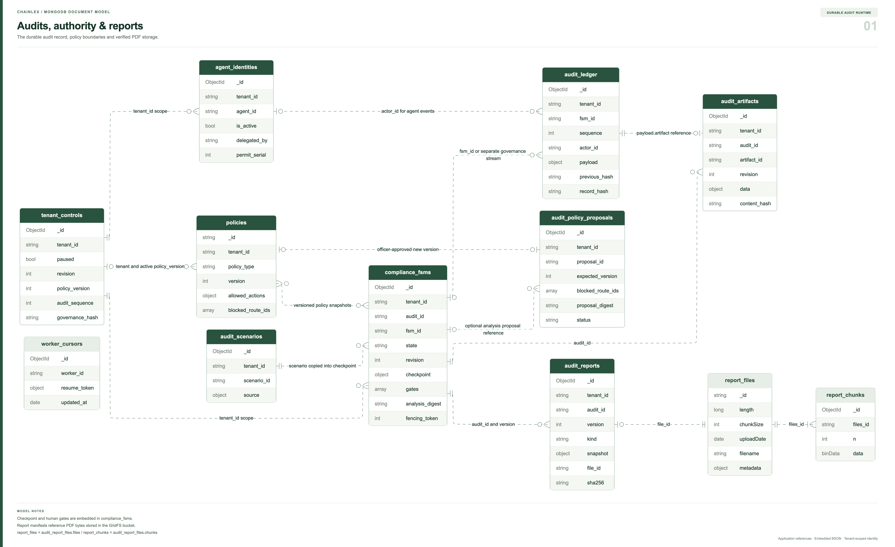

[Full-resolution PNG](./images/erd/audit-governance.png) · [Scalable SVG](./images/erd/audit-governance.svg)

Mermaid source

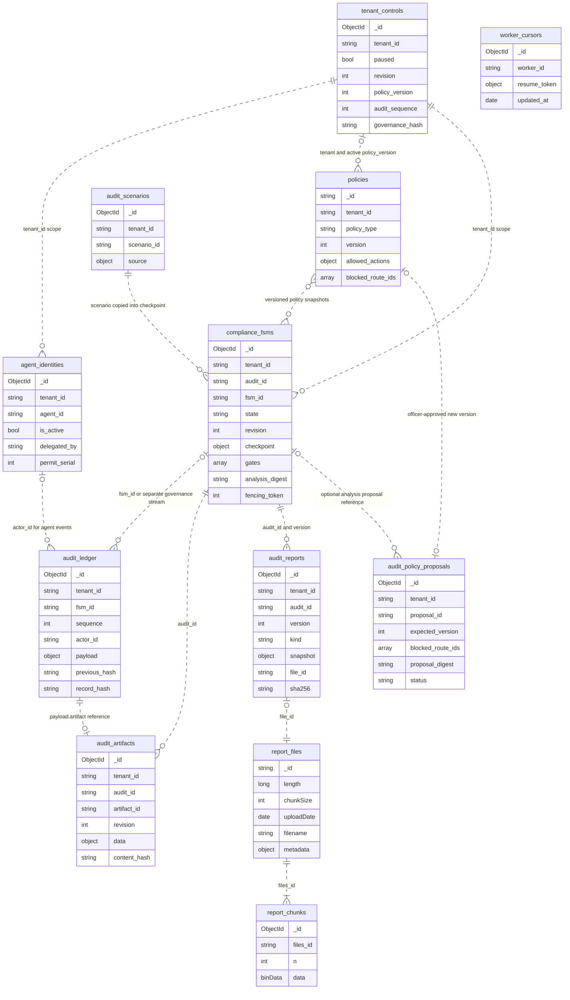

`report_files` and `report_chunks` are diagram aliases for the actual GridFS
collections **`audit_report_files.files`** and **`audit_report_files.chunks`**.
Incomplete uploads can leave chunks without a completed file. A completed file
can exist before a report manifest is committed. The application reconciles
these states rather than treating upload submission as publication success.

`worker_cursors` stores Change Stream position, not another business-state
machine. Its resume token subscribes to tenant-control changes; it is not a
foreign key into `tenant_controls`.

Governance ledger streams use `fsm_id = governance:{tenant_id}` and therefore
do not require a corresponding `compliance_fsms` document. Most durable audit
events do reference a real FSM.

### 1.2 Governed memory and regulatory evidence

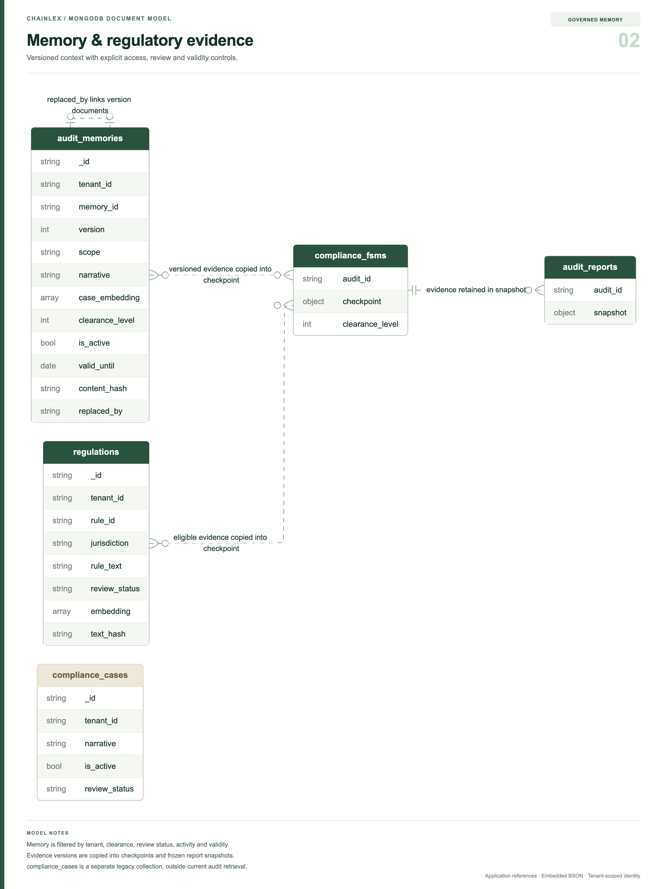

[Full-resolution PNG](./images/erd/governed-memory.png) · [Scalable SVG](./images/erd/governed-memory.svg)

Mermaid source

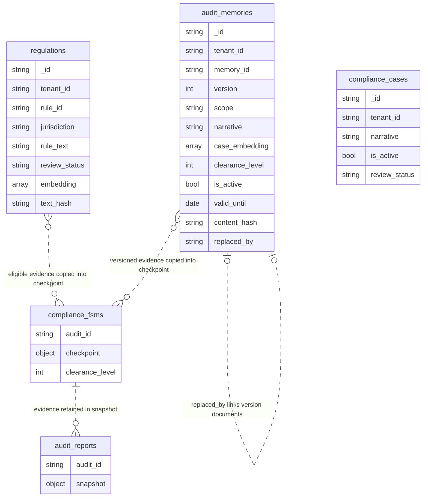

`checkpoint.evidence.memories[]` and `.regulations[]` are embedded snapshots,
not join tables. Retrieval uses Vector Search, followed by authoritative
document reads to reject stale, invalidated, expired, or inaccessible versions.
`compliance_cases` is a separate legacy precedent collection; the implemented
audit agent reads `audit_memories`, not `compliance_cases`.

### 1.3 Sepolia requests and their explicit handoff to audits

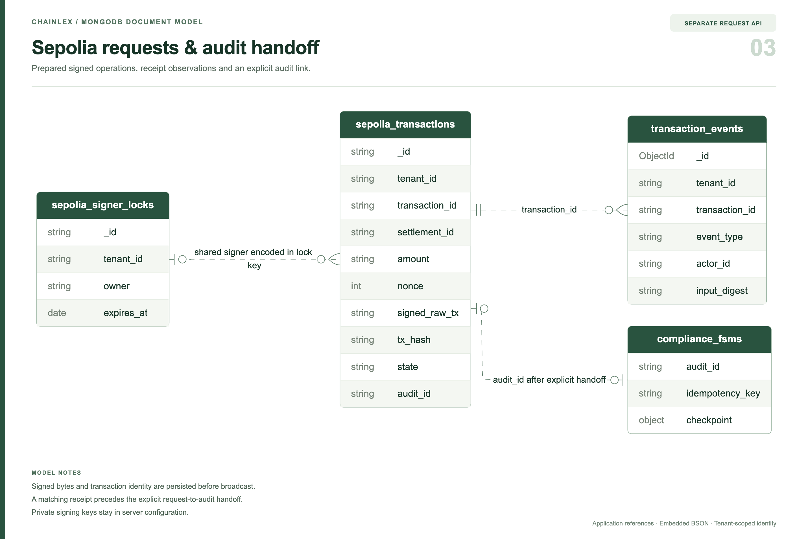

[Full-resolution PNG](./images/erd/sepolia-requests.png) · [Scalable SVG](./images/erd/sepolia-requests.svg)

Mermaid source

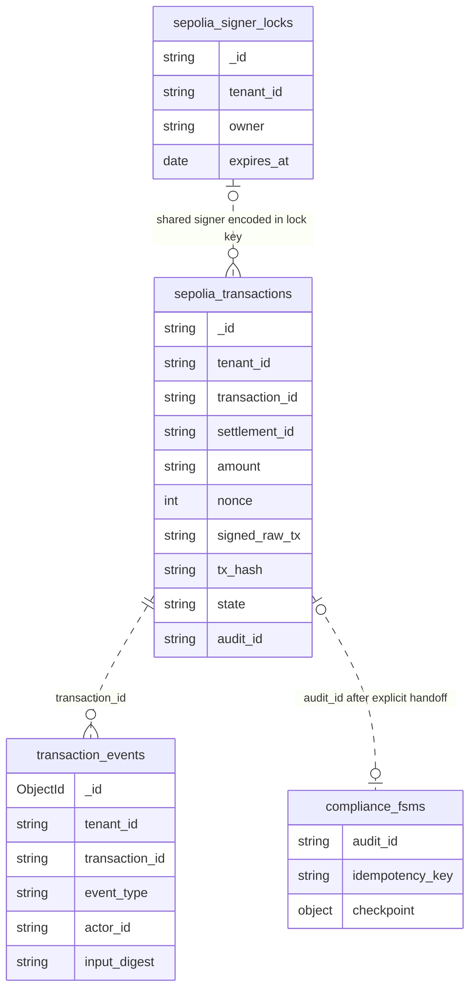

These three Sepolia collections are included in `bootstrap()` and receive the
common tenant/schema validator. Bootstrap also creates transaction-identity,
signer/nonce, and event-history indexes; the signer lease uses its `_id` key.
The request API persists prepared signed bytes in `sepolia_transactions`; it
does not route these requests through the separate `tx_outbox` collection.
Private signing keys stay in server configuration and are not stored here.

### 1.4 Separate indexer, simulator, and settlement contracts

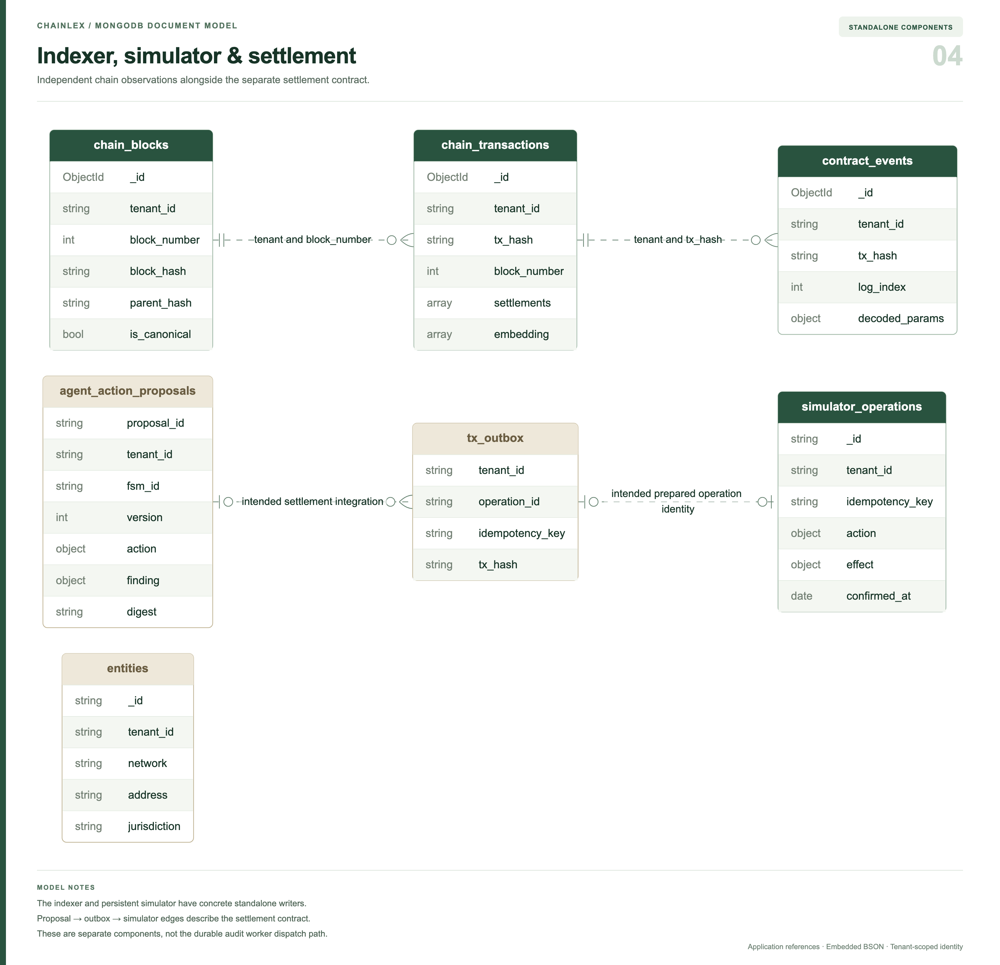

[Full-resolution PNG](./images/erd/settlement-indexer.png) · [Scalable SVG](./images/erd/settlement-indexer.svg)

Mermaid source

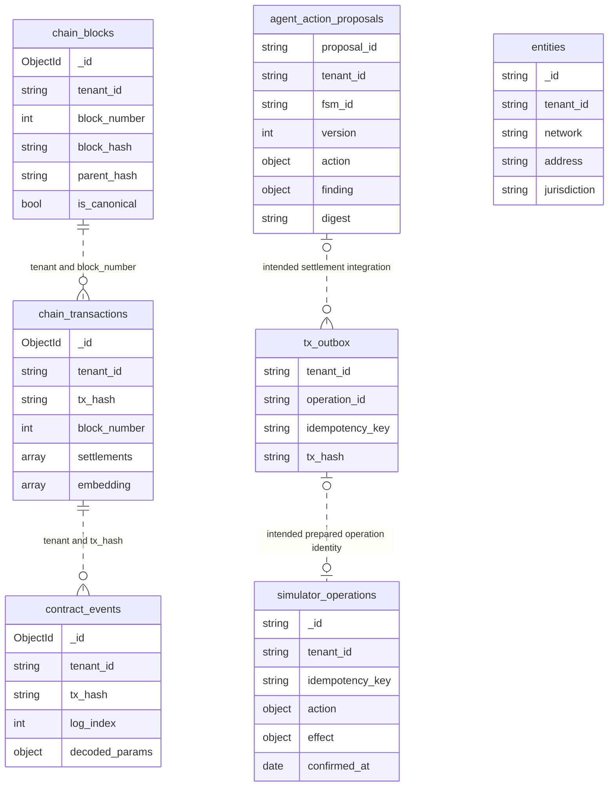

The last two edges describe the **settlement contract**, not a connected durable
audit execution path. `agent_action_proposals` has a typed proposal contract;
its decision handler still returns 501. The indexer and simulator have concrete
standalone writers. `entities` is seeded but scripted audit intake does not
resolve its counterparties from that collection.

## 2. Why MongoDB is modeled this way

- **Embed what must remain consistent together.** An audit's current checkpoint,
  bounded route candidates, findings, and human gates live in one FSM document.
  Simulator operation identity and its fictional hold effect also share a document.
- **Reference independently growing data.** Ledger events, artifact revisions,
  memories, policies, report versions, blockchain events, and PDF chunks have
  separate lifecycles and collections. Histories do not grow one unbounded array
  inside the FSM.
- **Snapshot the facts behind a decision.** Current working state may refresh;
  immutable artifacts and report snapshots retain the version actually reviewed.
- **Separate structure from authority.** MongoDB validators check document
  structure. Application code checks identity, tenant, clearance, policy,
  current evidence, and officer decisions. Shared database credentials do not
  themselves provide per-tenant document isolation.
- **Use transactions for business boundaries.** State, ordered event, artifact,
  and report-manifest changes commit together where the repository specifies.
  GridFS upload happens outside that transaction; publication requires a verified
  upload followed by a transactional manifest/state commit.
- **Use stable keys and compound indexes.** Tenant-scoped idempotency keys stop
  duplicate requests. Version and sequence indexes prevent duplicate revisions.
  Reference fields are application identifiers, not enforced foreign keys.
- **Keep money and time representations explicit.** Stored dates are UTC BSON
  dates where noted. Some event/snapshot timestamps are ISO strings. USDC request
  amounts and uint256 atomic amounts use strings; the legacy hold uses integer
  minor units. These representations are not interchangeable.

Common fields below apply to application-owned collections unless a section
explicitly describes a GridFS, legacy, or operational exception.

| Field | BSON shape | Why it exists |
|---|---|---|
| `_id` | ObjectId or explicit string | MongoDB document identity and built-in unique index. Content/version/idempotency keys use explicit strings where the writer defines them. |
| `tenant_id` | string | Application access boundary; included in queries and relevant compound indexes. Never accepted as a trusted client-body claim. |
| `schema_version` | integer | Version of the stored document format, independent of policy/memory versions. Generic bootstrap validation requires it to be at least 1. |

There are no `tenants`, `users`, `roles`, `banks`, `human_gates`, or `routes`
collections in this checkout. Tenant/role identity comes from server-bound tokens;
bank routes and human gates are embedded data. The three audit-agent identities
are `auditable_action`, `governed_memory`, and `durable_completion`. The separate
compliance court's prosecutor/defense/CCO roles are response objects, not these
persisted identities.

## 3. Collection and field dictionary

### 3.1 `compliance_fsms`: current durable audit state

**Why separate:** this is the worker's authoritative recovery and concurrency
record. New audit documents have `workflow_type = AUDIT`, `schema_version = 2`.
The separate settlement scaffold defines a version-1 document variant below.

| Field | Shape | Reason |
|---|---|---|
| `audit_id` | string | Public audit identifier. |
| `fsm_id` | string | Same value as `audit_id` for audits; shared identifier used by the ledger/indexes. |
| `workflow_type` | string | Distinguishes audit documents from the settlement scaffold. |
| `mode` | string | Records `scripted_demo` rather than implying live model reasoning. |
| `scenario` | string | Identifies the selected demo scenario. |
| `idempotency_key` | string | Deduplicates requests within the authenticated tenant. |
| `previous_audit_id` | string or null | Links a new evaluation to a previous audit without reopening its history. |
| `initiated_by` | string | Server-assigned initiating actor, currently `tenant:role`. |
| `clearance_level` | integer | Bounds evidence retrieval and who may read this audit and its reports. |
| `revision` | integer | Compare-and-swap concurrency version; advances with committed audit events. |
| `state` | string | Sole current business-state authority. |
| `checkpoint` | embedded document | Saved source, inputs, evidence, reasoning, and publication work; see section 4. |
| `gates` | array of embedded documents | Current version-bound officer decisions; no separate gate collection. |
| `analysis_digest` | string or null | Binds approval to the exact findings, context, evidence, and policy version. |
| `governance_revision` | integer or null | Tenant-control revision used for these findings; detects stale permissions/evidence. |
| `lease_owner` | string or null | Current worker/process claim. |
| `lease_expires_at` | BSON date or null | Allows recovery after the worker stops renewing ownership. |
| `fencing_token` | integer | Rejects writes by a previously owning worker after a newer claim. |
| `attempts` | integer | Persisted retry budget for the unfinished step. |
| `next_attempt_at` | BSON date or null | Durable retry timer. |
| `resume_state` | string or null | Original business-state recovery target, including when reconciliation itself fails in retry. |
| `error_code` | string or null | Reviewable failure classification without provider secrets. |
| `last_event_hash` | string | Expected ledger head; detects truncation as well as damaged internal events. |
| `created_at` | BSON date | Request creation time. |
| `updated_at` | BSON date | Last persisted business-state update; used for work ordering. |

`leg` is derived for API inspection and **is not persisted**. API responses hide
`checkpoint.query_vector` and in-progress `checkpoint.publication`.

Indexes: unique `(tenant_id, idempotency_key)` and `(tenant_id, fsm_id)`;
worker scheduling index `(workflow_type, state, lease_expires_at)`. The existing
`(state, runtime.lease.expires_at)` index belongs to the settlement contract.

### 3.2 `agent_identities`: delegated service identities

**Why separate:** revoking an agent must affect all its future operations, not
only one audit. A permit conditionally writes the identity inside its transaction
so concurrent revocation cannot race past an earlier advisory read.

| Field | Shape | Reason |
|---|---|---|
| `agent_id` | string | One of the three registered audit-agent identities. |
| `is_active` | boolean | Blocks new permits when false. |
| `mode` | string | Current registry scope is `scripted_demo`. |
| `delegated_by` | string | Authority source recorded on permitted actions; initial value is demo bootstrap. |
| `permit_serial` | integer, optional | Conditional-write counter serializing permits with identity changes. |
| `controlled_by` | string, optional | Officer who most recently activated/deactivated the identity. |
| `control_reason` | string, optional | Explanation for the authority change. |

Unique index: `(tenant_id, agent_id)`. These are application identities, not
MongoDB database users or stored API keys.

### 3.3 `tenant_controls`: shared governance boundary

**Why separate:** an audit permit and a concurrent pause/policy/memory update
must contend on the same document rather than inspect unrelated snapshots.

| Field | Shape | Reason |
|---|---|---|
| `paused` | boolean | Stops new action permits for the tenant. |
| `revision` | integer | Increments for effective governance changes; invalidates stale findings/approvals. |
| `policy_version` | integer | Active `AUDIT_AGENT_POLICY` version for this tenant. |
| `audit_sequence` | integer | Ordered sequence for this tenant's governance ledger stream. |
| `governance_hash` | string | Hash-chain head for that governance stream. |
| `audit_bootstrap_version` | integer, optional | Marks idempotent agent/scenario initialization as complete. |
| `action_serial` | integer, optional | Forces a write conflict between audit permits/guarded commits and governance changes. |
| `transaction_permit_serial` | integer, optional | Equivalent shared-write marker used by the newer Sepolia request API. |

Unique index: `tenant_id`. Pausing does not undo a previously sent operation;
saved upload outcomes can still be reconciled.

### 3.4 `policies`: three versioned document variants

**Why separate:** authorization rules are shared and versioned independently of
audits. A report retains the policy snapshot it actually used.

**Audit-agent policy** (`policy_type = AUDIT_AGENT_POLICY`):

| Field | Shape | Reason |
|---|---|---|
| `_id` | string | Writer uses `tenant:audit-agents:vN` for immutable version identity. |
| `policy_type` | string | Selects the audit-agent policy variant. |
| `version` | integer | Referenced by tenant control, action events, and analysis snapshots. |
| `mode` | string | Prevents describing demo permissions as production authority. |
| `allowed_actions` | document of string arrays | Explicit tool/action allowlist keyed by agent ID. |
| `blocked_route_ids` | string array | Officer-approved route restrictions applied during assessment. |
| `approved_by` | string | Actor authorizing this version; initial demo policy is bootstrap-authorized. |
| `proposal_digest` | string, optional | Links a later approved policy to the exact proposed content. |

**Internal review policy** (`policy_type = INTERNAL_DEMO`):

| Field | Shape | Reason |
|---|---|---|
| `_id` | string | Tenant, policy ID, and version form the ingestion key. |
| `policy_id`, `version` | string, integer | Stable rule identity and immutable revision. |
| `policy_type` | string | Selects the internal-review variant. |
| `jurisdiction` | string | Determines which corridor country the control concerns. |
| `source_rule_ids` | string array | References supporting regulation identities. |
| `required_fact` | string | Names the control fact the deterministic evaluator checks. |
| `description` | string | Human-readable purpose of the control. |
| `outcome` | string | These demo policies return `REVIEW`, not legal clearance. |
| `is_active`, `review_status` | boolean, string | Govern whether a seeded policy is operationally usable. New seeds are inactive/UNVERIFIED. |

**Bank admission policy** (`policy_type = BANK_ORIGINATOR_ALLOWLIST`):

| Field | Shape | Reason |
|---|---|---|
| `_id`, `policy_id`, `version` | string, string, integer | Tenant-scoped version identity as above. |
| `policy_type` | string | Selects the bank allowlist variant. |
| `bank_id` | string | Bank whose admission requirements this document expresses. |
| `scope` | string | `ORIGINATING_BANK` or `ALL_ROUTE_POSITIONS`; controls where originator checks apply. |
| `allowed_originators` | embedded array | Bounded wallet allowlist; each item has `wallet.network`, `wallet.address`, and optional `label`. |
| `wallet.network` | string | Separates identical address strings on different networks. |
| `wallet.address` | string | Normalized originator wallet identity. |
| `label` | string | Display context; never proof of wallet ownership. |
| `is_active`, `review_status` | boolean, string | Require reviewed activation before database-backed admission use. |

The bank lookup index is `(tenant_id, bank_id, policy_type, is_active)`. The audit
demo currently constructs ephemeral fictional bank policies during assessment;
its real database-backed action permissions use the audit-agent policy variant.
Collection access does not mean every policy subtype has been evaluated.

### 3.5 `audit_policy_proposals`: changes awaiting human authority

**Why separate:** an agent may suggest guardrails without rewriting its own
active policy. Human and agent-originated proposals share this collection.

| Field | Shape | Reason |
|---|---|---|
| `proposal_id` | string | Public proposal handle; agent proposals include policy/input identity to avoid stale reuse. |
| `status` | string | `PENDING`, `APPROVED`, or `REJECTED`; a rejected proposal is not relabeled as pending on replay. |
| `proposed_by` | string | Human actor or `auditable_action`. |
| `initiated_by` | string, optional | Human initiator retained on agent-originated proposals. |
| `expected_version` | integer | Exact active policy version against which the suggestion was made. |
| `reason` | string | Why the change is proposed. |
| `blocked_route_ids` | string array | Proposed new route-restriction set. |
| `proposal_digest` | string | Creation-time fingerprint of the original proposal; later status/decision updates do not rehash it. |
| `decided_by` | string, optional | Officer who made the governance decision. |
| `decided_at` | BSON date, optional | Decision time. |
| `decision_reason` | string, optional | Officer's explanation for approving/rejecting. |

Unique index: `(tenant_id, proposal_id)`. Approval creates a new `policies`
document and changes `tenant_controls.policy_version` transactionally. Report
sign-off is a separate action and cannot approve this proposal implicitly.

### 3.6 `audit_ledger`: ordered, reconstructable actions

**Why separate:** append history without making the live FSM document grow
forever. Audit and governance streams use the same collection with different
`fsm_id` values.

| Field | Shape | Reason |
|---|---|---|
| `fsm_id` | string | Audit ID, or `governance:{tenant_id}` for a governance stream. |
| `sequence` | integer | Detects missing/reordered events within that stream. |
| `event_id` | string | Unique event identity for deduplication. |
| `event_type` | string | Named action/transition/decision outcome. |
| `actor_id` | string | Responsible human or agent identity assigned by the server. |
| `occurred_at` | ISO UTC string | Stable timestamp representation used by canonical event hashing. |
| `payload` | embedded document | Event-specific facts described below. |
| `previous_hash` | string | Links the preceding event; genesis uses zeroes. |
| `record_hash` | string | Hash of this event's canonical content. |
| `anchor_tx_hash` | string, optional | External proof transaction written by standalone audit pinning. |
| `pinned_at` | BSON date, optional | Time standalone pinning recorded confirmation. |
| `merkle_root` | string, optional | Batch root used by that standalone anchor operation. |

Common payload fields: `initiated_by` identifies the original human;
`governance_revision` identifies the checked control version. Permit payloads
record `action`, `agent_id`, `policy_version`, `policy_digest`, `authority`,
`input_digest`, and `allowed`. Checkpoint events reference
`artifact.artifact_id` and `artifact.content_hash`. Gate decisions record
`gate_id`, `decision`, `expected_revision`, `analysis_digest`, and `reason`.
Recovery events add failure state, attempt/error code, operation identity, or
verified outcome. Governance events carry their specific mutation inputs.

Unique indexes: `(tenant_id, fsm_id, sequence)` and partial
`(tenant_id, fsm_id, event_id)`. The ledger is tamper-evident, not a promise that a
database administrator cannot rewrite data. Standalone pinning is not invoked by
the audit worker; its additional metadata needs compatibility review with the
current verifier, which excludes only `_id` and `record_hash` from event hashing.

### 3.7 `audit_artifacts`: immutable completed checkpoints

**Why separate:** refreshing mutable working state must not erase evidence that
an earlier decision used.

| Field | Shape | Reason |
|---|---|---|
| `audit_id` | string | Owning audit. |
| `artifact_id` | string | Stable `audit-id:rN` revision reference from the ledger. |
| `revision` | integer | FSM revision at which this checkpoint was committed. |
| `kind` | string | Event/step that produced the saved checkpoint. |
| `data` | embedded document | Full checkpoint snapshot at that revision. |
| `content_hash` | string | Integrity reference for the saved data. |

Unique index: `(tenant_id, artifact_id)`. These records commit with the state and
ledger event. Hashing normalizes BSON dates to UTC millisecond precision;
reproducing a hash from exported JSON requires restoring the typed dates.

### 3.8 `audit_memories`: governed, retrievable precedent versions

**Why separate:** memory must survive one audit and have its own access,
review, validity, and correction lifecycle.

| Field | Shape | Reason |
|---|---|---|
| `_id` | string | `tenant:memory-id:vN`, giving each version its own immutable identity. |
| `memory_id` | string | Logical memory identity across corrections. |
| `version` | integer | Exact version used in evidence/review. |
| `narrative` | string | Text embedded and retrieved semantically. |
| `route_id` | string | Corridor to which the precedent-driven review applies. |
| `required_gate` | string | Actual additional review requirement produced by this memory. |
| `clearance_level` | integer | Maximum visibility is bounded by server-assigned caller/audit clearance. |
| `valid_from`, `valid_until` | BSON dates | Application-enforced validity window; future retrieval excludes expired data. |
| `scope` | string | Isolates `scripted_demo` precedents from other intended environments. |
| `review_status` | string | Current audit-memory filter requires `REVIEWED_DEMO`. |
| `is_active` | boolean | Logical exclusion after correction/invalidation. |
| `is_demo_fixture` | boolean | Identifies the record as fictional demo material. |
| `approved_by` | string | Officer or explicit demo-fixture loader that created the reviewed-demo version. |
| `case_embedding` | array of 1024 numbers | Voyage document vector for Atlas memory search. |
| `text_hash` | string | Hash of the embedded narrative. |
| `embedding_model` | string | Current model is `voyage-finance-2`. |
| `embedding_version` | integer | Local embedding-format/version contract. |
| `content_hash` | string | Creation-time hash of version content/metadata, excluding `_id` and the vector; later lifecycle changes do not recompute it. |
| `replaced_by` | string, optional | Next version's actual MongoDB `_id`; stored on a corrected old version. |
| `correction_reason` | string, optional | Why that old version was superseded. |
| `invalidated_by` | string, optional | Actor withdrawing an active version. |
| `invalidated_at` | BSON date, optional | Withdrawal time. |
| `invalidation_reason` | string, optional | Why the version must not influence future audits. |

Unique index: `(tenant_id, memory_id, version)`. Vector index
`audit_memories_idx` searches `case_embedding` with tenant, scope, active/review
status, clearance, and date filters. `relevance_score` is added to retrieved
evidence snapshots; it is not stored by the memory-creation writer and is not a
compliance-confidence percentage. Invalidation is logical forgetting for future
retrieval; historical audit snapshots remain available.

### 3.9 `regulations`: attributed source-text versions

**Why separate:** source text, review, effective dates, and embeddings evolve
independently of an audit's snapshot.

| Field | Shape | Reason |
|---|---|---|
| `_id` | string | Tenant, rule ID, and embedded-text hash identify an ingested content version. |
| `rule_id` | string | Logical source-clause identifier. |
| `jurisdiction` | string | Country-level applicability and search filter. |
| `regulator` | string | Source authority attribution. |
| `title`, `section` | strings | Human-readable citation context. |
| `rule_text` | string | Stored summary/clause content to inspect. |
| `source_url` | string | Original reference location. |
| `retrieved_at` | string | Corpus attribution date as supplied by the source record. |
| `topics` | string array | Descriptive discovery context. |
| `applicability_notes` | string | Limits and relevant entity/activity context. |
| `example_query` | string | Corpus demonstration query; not a permission. |
| `source_kind` | string | Guidance versus notice-overview provenance. |
| `review_status` | string | Authoritative retrieval requires `VERIFIED`; seeding uses `UNVERIFIED`. |
| `valid_from`, `valid_until` | BSON date or null | Verified effective interval; an unknown start date does not become valid automatically. |
| `is_active` | boolean | Source version remains available for operational use. |
| `clearance_level` | integer | Access classification checked during and after retrieval. |
| `embedding` | array of 1024 numbers | Search vector for the formatted regulation text. |
| `text_hash` | string | Fingerprint of exactly the text used for embedding. |
| `embedding_model`, `embedding_version` | string, integer | Reproducibility and stale-embedding detection. |

`regulations_vector_idx` uses cosine similarity and governance filters. Search
is budgeted per jurisdiction so an intermediary country's evidence is not
crowded out by another country's results. `vector_score` is query output, not a
new stored authority field. Unverified seed summaries are not legal clearance.

### 3.10 `audit_scenarios`: tenant-owned source fixtures

**Why separate:** scenarios can be initialized idempotently and copied into an
audit without later fixture edits changing that audit's inputs.

| Field | Shape | Reason |
|---|---|---|
| `scenario_id` | string | Tenant-scoped selected fixture name. |
| `source` | embedded document | Bounded case context, routes, source references, and source schema version. |
| `mode` | string | Explicit `scripted_demo` provenance. |
| `is_demo_fixture` | boolean | Separates demonstration material from live client evidence. |

Unique index: `(tenant_id, scenario_id)`. The public scenario catalog is static
code; audit creation reads this tenant-owned stored source.

### 3.11 `audit_reports`: immutable report manifests and snapshots

**Why separate:** report versions outlive working-state changes and must point
to verified PDF bytes rather than an assumed successful upload.

| Field | Shape | Reason |
|---|---|---|
| `audit_id` | string | Owning audit. |
| `version` | integer | Monotonic publication version, including refreshed drafts. |
| `kind` | string | `DRAFT` or `REVIEWED_FINAL`; final does not imply approved settlement. |
| `analysis_digest` | string | Identifies the reviewed finding set behind the report. |
| `snapshot` | embedded document | Frozen content used to render the PDF; fields are explained in section 4. |
| `published_at` | BSON date | Time verified publication was committed. |
| `file_id` | string | Exact GridFS file identity. |
| `sha256` | string | PDF-byte integrity checksum, also verified during download. |
| `byte_length` | integer | Confirmed uploaded file size. |
| `snapshot_hash` | string | Binds the byte artifact's metadata to its source report snapshot. |
| `verified` | boolean | True only after successful read-back verification. |

Unique index: `(tenant_id, audit_id, version)`. List responses omit the large
snapshot. API download first scopes access through the owning audit, then checks
the stored PDF's digest.

### 3.12 GridFS: `audit_report_files.files` and `.chunks`

**Why separate:** binary PDF storage has a different lifecycle from the audit
metadata. GridFS chunks files and owns its own storage/index format.

| Collection / field | Shape | Reason |
|---|---|---|
| `files._id` | string in this application | Saved publication identity, including tenant, audit, report version, and attempt fence. |
| `files.length` | integer | GridFS byte length. |
| `files.chunkSize` | integer | GridFS storage chunk size. |
| `files.uploadDate` | BSON date | GridFS upload completion metadata. |
| `files.filename` | string | Human-readable download name. |
| `files.metadata` | embedded document | Application attribution and integrity values. |
| `metadata.tenant_id`, `metadata.audit_id` | strings | Owning tenant and audit. |
| `metadata.version` | integer | Source report version. |
| `metadata.snapshot_hash`, `metadata.sha256` | strings | Source snapshot and PDF-byte integrity checks. |
| `chunks._id` | ObjectId | MongoDB chunk identity. |
| `chunks.files_id` | string in this application | Parent file's `_id`. |
| `chunks.n` | integer | Zero-based chunk position. |
| `chunks.data` | binary | Stored PDF bytes for that chunk. |

The GridFS driver manages its file/chunk indexes, including unique
`(files_id, n)` for chunks. Chunk documents do not have application tenant/schema
fields. Access is enforced through the tenant-scoped report manifest and audit.
Do not apply the generic application validator to the GridFS bucket.

### 3.13 `worker_cursors`: resumable notifications

**Why separate:** a Change Stream position must survive process restart without
being confused with verified business progress.

| Field | Shape | Reason |
|---|---|---|
| `tenant_id` | string | Worker metadata uses the reserved `__system__` scope. |
| `worker_id` | string | Stable `audit-controls:{configured-worker-id}` subscription identity. |
| `resume_token` | BSON document | Opaque MongoDB Change Stream resume position; never an application-generated cursor. |
| `updated_at` | BSON date | Last persisted stream position. |

Unique index: `worker_id`. Polling and authoritative reads remain available if
stream history expires or notifications are unavailable.

### 3.14 `entities`: seeded party identities

**Why separate:** intended exact wallet/network lookup source, independent of
transaction narratives. Scripted audit intake currently uses scenario context.

| Field | Shape | Reason |
|---|---|---|
| `_id` | string | Known fixture identity. |
| `network`, `address` | strings | Intended exact party lookup; address alone is not network identity. |
| `label` | string | Fictional display name. |
| `jurisdiction` | string | Source country claim; legacy fixtures use USA/SGP rather than the route model's US/SG. |
| `is_demo_fixture` | boolean | Identifies seed-owned data. |
| `review_status` | string | Makes unverified party claims explicit. |

Unique index: `(tenant_id, network, address)`. The fixture writer does not store
an `is_active` field on entities. Country-code normalization would be needed
before using legacy fixture claims directly as route-country values.

### 3.15 `compliance_cases`: legacy precedent fixtures

**Why separate:** older historical-case/precedent design, not the audit agent's
currently implemented governed-memory collection.

| Field | Shape | Reason |
|---|---|---|
| `_id` | string | Known historical fixture identity. |
| `narrative` | string | Fictional precedent description. |
| `is_demo_fixture` | boolean | Identifies seed-owned records. |
| `review_status` | string | Seed value is UNVERIFIED. |
| `is_active` | boolean | Seed value is false, preventing assumed operational use. |

The `case_precedents_idx` definition additionally expects `case_embedding`,
`clearance_level`, `valid_from`, and `valid_until` for governed search. The seed
writer does not populate these fields or embeddings; an index definition is not
proof that such records exist or are queried by the audit runtime.

### 3.16 `sepolia_transactions`: prepared request and observed receipt

**Why separate:** persists signed bytes before broadcast, then distinguishes
submission from matching on-chain receipt evidence.

| Field | Shape | Reason |
|---|---|---|
| `_id` | string | `tenant:idempotency-key`; prevents duplicate preparation for the same request. |
| `transaction_id` | string | Public API handle. |
| `settlement_id` | string | Contract request identity emitted in the expected event. |
| `amount` | decimal string | Exact USDC display amount, converted to six-decimal atomic units when encoding. |
| `beneficiary` | address string | Destination wallet, normalized and nonzero. |
| `asset_contract` | address string | Asset identity encoded into the request. |
| `route_id` | string | One of the two configured fictional bank corridors. |
| `idempotency_key` | string | Original request deduplication key. |
| `input_digest` | string | Rejects reuse of that key with different request content. |
| `chain_id` | integer | Must be Ethereum Sepolia, 11155111. |
| `signer` | address string | Backend operational account; the private key is not stored. |
| `contract_address` | address string | Intended request contract. |
| `nonce` | integer | Assigned signer sequence, serialized by the signer lock. |
| `signed_raw_tx` | string | Durable rebroadcastable bytes; intentionally excluded from public responses. |
| `tx_hash` | string | Deterministic identity of the signed transaction before network send. |
| `state` | string | PREPARED, SUBMITTED, SUBMISSION_UNKNOWN, CONFIRMED, REVERTED, or RECEIPT_REQUIRES_REVIEW. |
| `initiated_by` | string | Officer actor authorizing the request API call. |
| `created_at`, `updated_at` | BSON dates | Request preparation and latest observed-state update. |
| `block_number` | integer, optional | Receipt's block after probing. |
| `audit_id` | string, optional | Set only by the explicit confirmed-request-to-audit handoff. |

Public responses use an allowlist and omit tenant/internal authority, nonce,
input digest, and signed bytes. Bootstrap applies the common tenant/schema
validator and unique `(tenant_id, transaction_id)` and `(chain_id, signer, nonce)`
indexes. The signer/nonce index intentionally crosses tenant boundaries when
tenants share a signing account. Receipt matching is not the same
as completed payment or a compliance approval, and the API probe does not apply
the standalone connector's configurable confirmation-depth/reorg procedure.

### 3.17 `sepolia_signer_locks`: shared nonce-preparation lease

**Why separate:** multiple requests/tenants may use one signer, so nonce
preparation must serialize by signer rather than by audit ID.

| Field | Shape | Reason |
|---|---|---|
| `_id` | string | `sepolia:{lowercase-signer}`; deliberately a signer-wide lock key. |
| `owner` | string, optional | Random preparation owner. |
| `expires_at` | BSON date, optional | Allows acquisition after an abandoned preparation lease. |
| `tenant_id`, `schema_version` | string, integer | Attribution for the current lock write. |

Successful persistence and the finally path unset `owner`/`expires_at`; the lock
document may remain. These are lease fields, not a configured TTL deletion.

### 3.18 `transaction_events`: request submission authority

**Why separate:** records the Sepolia request's submission permit independently
from a later optional compliance audit.

| Field | Shape | Reason |
|---|---|---|
| `transaction_id` | string | Owning request API record. |
| `event_type` | string | Current writer records `SUBMISSION_PERMITTED`. |
| `actor_id` | string | Officer authorizing the request. |
| `occurred_at` | BSON date | Permit transaction time. |
| `input_digest` | string | Exact request content covered by the permit. |
| `tx_hash` | string | Prepared signed operation identity. |

This writer does not append every broadcast/probe transition here, and the
collection is not the hash-linked `audit_ledger`. Bootstrap provides the common
tenant/schema validator and nonunique `(tenant_id, transaction_id)` history index.

### 3.19 `chain_blocks`: canonical-chain observations

**Why separate:** supports reorg detection and invalidation of downstream indexed
transactions/events independently of audit reports.

| Field | Shape | Reason |
|---|---|---|
| `block_number` | integer | Indexed height. |
| `block_hash` | string | Identifies the observed block at that height. |
| `parent_hash` | string | Detects a fork from the previously stored parent. |
| `timestamp` | source timestamp | Chain timestamp supplied to the indexer, not an application approval time. |
| `is_canonical`, `is_orphaned` | booleans | Current indexed-chain interpretation after reorg checks. |

Unique index: `(tenant_id, block_number)`; lookup index on `(tenant_id, block_hash)`.
This writer does not store `chain_id` on block documents, and current block keys
do not partition multiple networks within one tenant.

### 3.20 `chain_transactions`: indexed chain data and optional vectors

**Why separate:** supports transaction/event inspection and semantic search,
without using mutable indexer documents as the only audit evidence.

| Field | Shape | Reason |
|---|---|---|
| `tx_hash` | string | Transaction identity within the current tenant's chain index. |
| `from`, `to` | strings | Normalized sender/recipient addresses. |
| `value_minor`, `currency` | integer, string | Legacy narrative amount representation; routed assets use their own atomic fields. |
| `chain_id` | integer | Network attribution from the indexer. |
| `block_number`, `block_hash`, `timestamp` | integer, string, source time | Location and time of the indexed observation. |
| `status` | source status | Receipt/execution-status input, distinct from a compliance verdict. |
| `input_data` | string | Encoded transaction call input. |
| `settlements` | embedded array | Decoded `RoutedSettlement` requests attached by the indexer. |
| `is_canonical`, `is_orphaned` | booleans | Exclude reorg-invalidated observations. |
| `narrative` | string, optional | Text generated by the standalone transaction vectorizer. |
| `embedding` | numeric array, optional | Real or explicitly injected test vector used by the standalone semantic-search component. |
| `text_hash`, `embedding_model`, `embedding_version` | string, string, integer, optional | Track the exact embedded narrative and embedding contract. |

Unique index: `(tenant_id, tx_hash)`; block lookup `(tenant_id, block_number)`.
`chain_transactions_idx` filters tenant/addresses/canonical status. It is separate
from `sepolia_transactions`: the request API does not automatically populate the
indexer collection. A `memo` can be read when supplied by an external writer, but
the indexer shown here does not persist one.

### 3.21 `contract_events`: decoded contract log observations

**Why separate:** a transaction can emit many logs and event consumers need
independent deduplication and reorg visibility.

| Field | Shape | Reason |
|---|---|---|
| `tx_hash` | string | Source transaction. |
| `log_index` | integer | Distinguishes multiple logs in one transaction. |
| `contract_address` | string | Contract emitting the log. |
| `event_name` | string | ABI-decoded event type. |
| `decoded_params` | embedded document | Event-specific decoded arguments. |
| `block_number`, `block_hash`, `chain_id` | integer, string, integer | Source chain observation. |
| `is_orphaned` | boolean | Prevents treating a removed-chain event as current evidence. |

Unique index: `(tenant_id, tx_hash, log_index)`; event lookup
`(tenant_id, event_name, is_orphaned)`. Routed-event payloads include the asset,
route, wallets, instruction commitment, and unverified institution claims
described in section 4.

### 3.22 `simulator_operations`: atomic fictional hold effect

**Why separate:** the simulator is an independently running external-system
stand-in. Its own persisted effect survives audit-worker restarts.

| Field | Shape | Reason |
|---|---|---|
| `_id` | string | Prepared `operation_id`; simulator responses expose this as the operation handle. |
| `idempotency_key` | string | Tenant-scoped downstream delivery deduplication. |
| `payload_digest` | string | Rejects reuse of an operation key for another action. |
| `action` | embedded HoldAction | Tenant, settlement, integer `amount_minor`, `currency`, and `action_type`. |
| `effect` | embedded document | Stores `settlement_id` and fictional status `HELD` atomically with operation identity. |
| `created_at` | BSON date | First successful simulator dispatch. |
| `confirmed_at` | BSON date | Time after which probes return CONFIRMED rather than PENDING. |
| `is_simulated` | boolean | Prevents presenting the effect as a real-chain action. |

Unique index: `(tenant_id, idempotency_key)`. The durable audit workflow does not
invoke this simulator. Its separate API validates the prepared operation before
persisting it.

### 3.23 `agent_action_proposals`: settlement proposal contract

**Why separate:** intended immutable financial-action proposal subject to officer
review. This is **not** `audit_policy_proposals`, which changes agent guardrails.

| Contract field | Shape | Reason |
|---|---|---|
| `proposal_id` | string | Intended public financial proposal identity. |
| `fsm_id` | string | Owning settlement FSM. |
| `version` | integer | Proposal revision used by an officer decision. |
| `action` | embedded HoldAction | Exact proposed hold target and amount. |
| `finding` | embedded Finding | Evidence-supported-risk or review-required finding. |
| `policy_version` | integer | Authorization policy version the proposal assumes. |
| `digest` | string | Exact content officer authorization must bind to. |

`finding` contains `verdict`, `explanation`, `evidence[]`, `precedent_ids[]`,
`missing_facts[]`, `model`, and `prompt_version`. Each evidence reference contains
`document_id`, `version`, and `text_hash` to identify the cited source version.
These fields are a typed contract; the settlement decision route still returns
501 and the audit worker does not write these proposals. The Pydantic proposal
contract does not itself add `schema_version`; a future persistence writer must
add it to satisfy bootstrap validation. Unique index:
`(tenant_id, fsm_id, version)`.

### 3.24 `tx_outbox`: reserved settlement delivery record

**Why separate:** intended boundary between a durable financial authorization and
retryable delivery. It is not the audit worker's PDF-publication mechanism.

| Field known to current code | Shape | Reason / implementation boundary |
|---|---|---|
| `idempotency_key` | string | Expected by the unique tenant/action-key index; no connected audit writer fills it. |
| `state`, `next_attempt_at` | string, date | Expected by the pending-action scheduling index; a complete outbox state writer is still absent. |
| `operation_id` | string | Optional standalone EVM connector's persisted operation lookup. |
| `tx_hash` | string | Optional standalone EVM connector's dispatch result. |

Unique index: `(tenant_id, idempotency_key)`; scheduling index
`(state, next_attempt_at)`. Do not infer a complete outbox schema from those
indexes. The optional connector's upsert writes tenant/operation/hash but does
not add required `schema_version` or the indexed idempotency key; it needs an
integration fix before use against bootstrap's validator. The newer Sepolia
request API has its own durable signed-byte record instead.

### 3.25 `e2e_test_results`: retained test evidence, not a product collection

**Why separate:** the inspection harness leaves a human-readable verification
summary without mixing test assertions into the application's ledger.

| Harness field | Shape | Reason |
|---|---|---|
| `_id` | string | `inspectable-e2e-result` lookup handle. |
| `status`, `database`, `retained`, `completed_at` | string, string, boolean, ISO string | Test outcome, namespace, retention intention, and completion time. |
| `mode`, `real_services`, `human_decisions`, `financial_actions` | string, array, string, boolean | Distinguishes scripted reasoning and simulated officer reviews from real infrastructure. |
| `original_database`, `original_database_unchanged`, `original_database_fingerprint` | string, boolean, string | Scope and fingerprint comparison for the completed retained test run. |
| `connection_string_template` | string | Connection guidance containing a password placeholder, never credentials. |
| `seed` | embedded document | Seeding counts/status, including embedding phase. |
| `checks` | embedded array | Each item records `check`, `passed`, and optional test details. |
| `audits` | embedded array | Test label, audit ID/state/scenario, verdict, recommended route, memory influence, gate/event counts, and report version/hash summaries; manual-stop entries instead carry an error code. |
| `collection_coverage` | embedded array | Collection, record count, runtime read/write command counts, classification, and explanation. |
| `collection_usage_summary` | embedded document | Counts of runtime-used, seeded-only, unused-in-audit, and test-evidence collections. |
| `inspection_queries` | string array | Suggested Compass/mongosh inspection statements. |
| `artifact_hash_encoding` | string | Explains BSON-date canonicalization for checksum reproduction. |
| `error_type`, `error` | strings, failed harness attempts only | Preserve why an inspectable test attempt stopped; not an application's audit verdict. |

This collection is created by the external test harness, not `bootstrap()`.
The retained audit-only test exercised 14 runtime/storage collections, seeded
`entities`/`compliance_cases` without reading them in the workflow, and left six
settlement/indexer collections unused. Its coverage does not claim to test the
newer Sepolia request or compliance-court API paths.

`_preflight` is an operational scratch collection whose temporary documents have
`_id` and `phase`; the CLI removes its marker after checking transactions.
`_preflight_test` and `job_executions` are legacy/test namespaces, not current
domain collections. No current schema or workflow should be inferred from an
empty leftover collection.

## 4. Embedded document dictionary

### 4.1 `checkpoint` and its publication work

| Field | Shape | Why embedded / field purpose |
|---|---|---|
| `source` | document | Original copied scenario or upstream request, preserving intake inputs. |
| `context` | document | Validated/adapted source; preserves adapter identity and normalized bank layout. |
| `query_vector` | numeric array | Saved real Voyage query embedding; a later search failure does not re-embed it. |
| `evidence` | document | Source/memory snapshots and coverage status used by analysis. |
| `analysis` | document | Assessed candidates, findings, memory comparison, and proposed gates. |
| `policy_version` | integer | Policy version used by this assessment. |
| `policy_snapshot` | document | Exact policy content for reconstruction, even after active policy changes. |
| `publication` | document, optional | In-progress immutable snapshot and saved external upload identity. |
| `publication.snapshot` | document | Frozen report content to render/reconcile. |
| `publication.version` | integer | Intended report version. |
| `publication.attempt_fence` | integer | Distinguishes an interrupted worker's upload attempt. |
| `publication.file_id` | string | Saved GridFS operation identity before upload. |
| `publication.receipt` | document or null | Verified existing-file outcome after reconciliation. |
| `publication.next_probe_at` | BSON date, optional | Limits repeated read-only probes during pause/early retry. |
| `draft_receipt`, `final_receipt` | documents, optional | Saved report `version`, `kind`, `file_id`, `sha256`, `byte_length`, `snapshot_hash`, and `verified` outcome. |

### 4.2 Scenario/source/context and routes

| Field | Shape | Reason |
|---|---|---|
| `schema_version` | integer | External source layout version; 1/2 have adapters, 99 is the unsupported fixture. |
| `description`, `narrative` | strings | Scenario description and exact factual embedding input. |
| `asset`, `network`, `amount` | strings | Case asset/network and display amount; the audit's string amount is not a hold's integer `amount_minor`. |
| `origin`, `destination` | strings | Required corridor endpoint bank IDs. |
| `routes` | embedded array | Bounded candidates with `route_id`, `provenance`, `banks[]`, and optional `connectivity_verified`. |
| `route_id` | string | Stable comparison/selection identity. |
| `provenance` | string | Configured fixture versus attributed research-style fixture candidate. |
| `connectivity_verified` | boolean, optional | Makes missing corridor verification explicit. |
| `banks` | embedded array | Ordered `bank_id` / `jurisdiction` objects; order is part of route meaning. |
| `institutions` | embedded array, source-v2 only | Older/newer source-layout field adapted explicitly to `banks`; not another collection. |
| `sources` | embedded array | Source references with `source_id`, `jurisdiction`, `title`, `url`, `review_status`, and `provenance`. |
| `source_id`, `title`, `url` | strings | Identify, label, and locate the reference. |
| `jurisdiction`, `review_status`, `provenance` | strings | Record applicability, unverified status, and fixture origin; URLs do not verify connectivity. |
| `originator_admitted` | boolean | Fictional bank-admission scenario control. |
| `fixture_version` | string | Identifies the scripted scenario generation contract. |
| `adapter`, `source_schema_version` | string, integer, context only | Records the explicit reviewed normalization used. |
| `transaction_reference` | document, upstream only | Real Sepolia `tx_hash`, `settlement_id`, `block_number`, and explorer `url`; does not prove bank relationships. |

### 4.3 Evidence and analysis

| Field | Shape | Reason |
|---|---|---|
| `evidence.memories`, `evidence.regulations` | embedded arrays | Eligible source-version snapshots; field meanings reuse their collection dictionaries. |
| `evidence.memory_search_status`, `evidence.regulation_search_status` | strings | Distinguish complete search from unavailable coverage. |
| `evidence.embedding_model`, `evidence.scope` | strings | Retrieval model and demo-scope attribution. |
| `analysis.agent_id`, `reasoning_mode`, `fixture_version` | strings | Attributes the finding to a specific agent and scripted reasoning contract. |
| `finding`, `explanation` | strings | Structured review finding and inspectable explanation. |
| `verdict` | string | Current assessment yields CONDITIONAL or NO_SUITABLE_ROUTE. |
| `recommended_route_id` | string or null | Selected eligible candidate; null when every route is denied. |
| `routes` | embedded array | Ranked comparisons with banks, provenance, checks, and unresolved issues. |
| `bank_checks` | embedded array | Each bank's `bank_id`, zero-based `position`, `outcome`, `reason`, and applicable `policy_id`/`policy_version`. |
| `jurisdiction_checks` | embedded array | `jurisdiction`, `outcome`, `rule_ids[]`, and review `reason` for every route country. |
| `issues`, `unresolved_checks`, `hop_count` | array, integer, integer | Explain and deterministically rank candidates; no invented fees or timing. |
| `outcome`, `policy_provenance` | strings | Candidate result and explicit fictional-policy attribution. |
| `gates` | embedded array | Proposed gate definitions copied into the FSM's current `gates`. |
| `memory_comparison` | document | Saved evaluation with and without memory. |
| `memory_comparison.input_digest` | string | Confirms the same case inputs were compared. |
| `memory_versions` | embedded array | Memory ID, version, and content hash used in the comparison. |
| `without_memory`, `with_memory` | documents | Route/verdict/check results for the two evaluations. |
| `behavior_changed` | boolean | Whether memory changed the route-check output; extra gates are also observable in the audit. |
| `interpretation` | string | States the deterministic ablation limit; it is not proof of LLM causality. |
| `policy_proposal` | document, optional | Proposal ID, digest, and status at analysis; a report may capture a later decision snapshot. |

### 4.4 `gates[]`: human decisions embedded in the FSM

| Field | Shape | Reason |
|---|---|---|
| `gate_id` | string | Stable decision target inside this audit. |
| `title`, `reason` | strings | What must be reviewed and why the gate exists. |
| `required` | boolean | Gate requirement metadata; current generated gates are required. |
| `status` | string | PENDING, APPROVED, or REJECTED. |
| `decision_reason` | string or null | Officer's recorded explanation. |
| `actor_id` | string or null | Server-assigned deciding identity. |
| `decided_at` | BSON date or null | Decision time. |

The HTTP decision also requires `analysis_digest` and `expected_revision`.
Those bind the mutation to the current FSM; the gate does not store independent
approval authority detached from its owning analysis. The final-signoff handler
requires all preceding gates to be resolved. Current control flow checks gate
status/order rather than treating `required` as an optional-gate bypass.

### 4.5 `audit_reports.snapshot`

| Field | Shape | Reason |
|---|---|---|
| `tenant_id`, `audit_id` | strings | Ownership attribution within the archived content. |
| `kind`, `version`, `mode` | string, integer, string | Report version/type and scripted-demo attribution. |
| `created_at` | ISO UTC string | Snapshot assembly time, distinct from manifest commit time. |
| `initiated_by`, `analysis_digest` | strings | Request authority and reviewed analysis identity. |
| `analysis`, `context`, `policy`, `evidence`, `gates` | embedded documents/array | Exact reviewed material; meanings reuse the dictionaries above. |
| `agents` | embedded array | `agent_id`, display `name`, and hackathon `statement` attribution. |
| `events` | embedded array | Ordered timeline through the snapshot cutoff; final publication receipt necessarily follows PDF generation. |
| `verdict` | string | Assessment outcome, or HUMAN_REJECTED when a final report contains a rejected gate. |
| `policy_proposal` | document, optional | Stored proposal and decision status captured for this report. |

### 4.6 Routed settlements and legacy settlement FSM objects

An indexed `settlements[]` or decoded routed event contains `event_version`,
`settlement_id`, `initiator_wallet`, `beneficiary_wallet`, `asset`, `route`,
`instructions_hash`, and `institution_verification`. `event_version` selects the
ABI/domain layout; wallets identify participants; the instruction hash commits
off-chain instructions; institution claims remain UNVERIFIED.

`asset` embeds `amount_atomic` (decimal uint256 string), `symbol`, `decimals`,
and `contract_address`. This preserves large values without BSON int64 overflow.
`route` embeds `route_id` and ordered `banks[]`, each with `bank_id` and
`jurisdiction`. Request-created amounts, events, and actual payment finality are
different facts.

The unimplemented settlement-FSM variant uses `settlement_id`,
`previous_fsm_id`, `revision`, `state`, `runtime`, `artifacts`, `last_event`,
`wait`, and `blocking_reason_codes` alongside its common/FSM identity fields.
`runtime` holds `lease.worker_id`, `lease.fencing_token`, `lease.expires_at`,
`attempt`, `next_attempt_at`, and `reconciliation_deadline` for safe recovery.
`artifacts` references saved results; `last_event` and `wait` preserve event and
state-specific recovery context. `blocking_reason_codes` explains an approval
wait. The exact state/event/checkpoint contract is in [the FSM reference](./fsm.md).
These fields are not the audit document's top-level lease/checkpoint layout.

Additional nested settlement-contract fields are:

| Embedded contract / fields | Reason |
|---|---|
| `ArtifactReference.artifact_id`, `kind`, `version`, `digest` | Identify the exact saved result and its revision/content rather than a mutable in-memory value. |
| `ComplianceEvent.event_id`, `fsm_id`, `tenant_id` | Deduplicate and scope the transition envelope. |
| `ComplianceEvent.event_type`, `source`, `actor_id` | Identify the named event, permitted source category, and responsible actor. |
| `ComplianceEvent.expected_revision`, `expected_state` | Reject stale or out-of-order transition requests. |
| `ComplianceEvent.occurred_at`, `artifacts` | Timestamp the event and reference persisted results required by its guard. |
| `WaitCheckpoint.kind`, `origin_state`, `resume_state` | Distinguish retry/input/manual recovery and preserve its allowed business boundary. |
| `WaitCheckpoint.reason_codes` | Explain the wait to an operator. |
| `WaitCheckpoint.input_revision`, `input_digest` | Prevent resuming against changed inputs. |
| `WaitCheckpoint.attempt`, `next_attempt_at` | Persist consumed retry budget and due time. |

These are typed settlement interfaces; they are not extra collections or a claim
that the settlement FSM instance handlers execute them today.

## 5. API request fields and authorization

All durable audit/governance and transaction APIs use server-bound bearer
identities. Analyst and officer map to clearance 1 and 2 for audit/memory reads.
An officer can perform general reads; officer-only mutations use `require_officer`.
Database access scopes data by the authenticated tenant, not body claims.

| Request | Fields and why they exist |
|---|---|
| `CreateAudit` | `scenario` selects source; `idempotency_key` deduplicates; optional `previous_audit_id` links a new evaluation. |
| `GateDecision` | `decision` records APPROVE/REJECT; `analysis_digest` binds content; `expected_revision` binds current state; `reason` records human authority. |
| `RetryAudit` | `expected_revision` targets the current manual checkpoint; `reason` explains the retry request. |
| `AgentControl` | `is_active` enables/revokes the identity; `reason` records why. |
| `ControlRequest` | `paused` changes the shared tenant action gate. |
| `MemoryCreate` | `narrative` is embedded; `route_id` scopes influence; `required_gate` changes behavior; `clearance_level` limits readers; `valid_until` requires future expiry. |
| `MemoryCorrection` | All creation fields plus `expected_version` and correction `reason`; new version replaces the active old one. |
| `MemoryInvalidation` | `expected_version` prevents withdrawing the wrong revision; `reason` records why. |
| `PolicyChange` | `expected_version` binds the base policy; `blocked_route_ids` proposes restrictions; `reason` explains the suggestion. |
| `PolicyChangeDecision` | `decision`, `expected_version`, `reason` authorize/reject exactly the pending proposal/base version. |
| `CreateTransaction` | `amount`, `beneficiary`, `asset_contract`, `route_id`, `idempotency_key` encode and deduplicate a Sepolia request. No signer/private key is accepted from the client. |
| `CreateFSM` | Legacy `scenario`, `idempotency_key`, optional `previous_fsm_id`; validated before the scaffold returns 501. |
| `ProposalDecision` | Legacy `decision`, `proposal_version`, `reason`; currently returns 501 after officer authorization. |
| `PreparedAction` | Separate simulator body: embedded `action`, `idempotency_key`, `operation_id`, `payload_digest`; simulator recomputes/validates identities before persistence. |

For `VerifyComplianceRequest`, the fields are request-local demo inputs, not a
new MongoDB collection:

| Fields | Reason |
|---|---|
| `scenario` | Selects custom/cross-country/hack-style/multihop/sanctions fixture overrides. |
| `origin_bank`, `origin_country`, `inter_banks`, `inter_countries`, `dest_bank`, `dest_country` | Constructs the ordered route; intermediary arrays must match. |
| `amount`, `symbol`, `decimals` | Demo amount and atomic-unit conversion. |
| `initiator_address`, `beneficiary_address` | Participant domain checks. |
| `cdd_complete`, `travel_rule_complete`, `sanctions_clear`, `beneficial_ownership_checked` | Deterministic demo control facts, not external screening-service results. |
| `wash_trade`, `zero_instructions_hash`, `rogue_sender`, `strict_intermediary` | Explicit scenario/failure toggles. |
| `mode` | `simulated` uses mocked RPC; `sepolia` can invoke real RPC/hold submission. |

The court response contains `settlement_id`, `route_summary`, prosecutor/defense/
CCO submissions, `final_verdict`, `recommended_action`, and
`requires_on_chain_hold`. Each submission has `agent_role`, `advocated_verdict`,
`charges_or_exemptions`, `statutory_citations`, `reasoning_summary`, and
`confidence_score`. These are scripted response values; scores are not calibrated
legal confidence and the named CCO role is not a human officer approval record.

## 6. API flow diagrams

### 6.1 Audit creation, asynchronous execution, and officer review

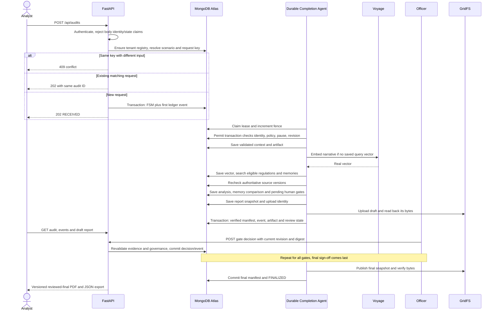

### 6.2 Human-gate decision branches

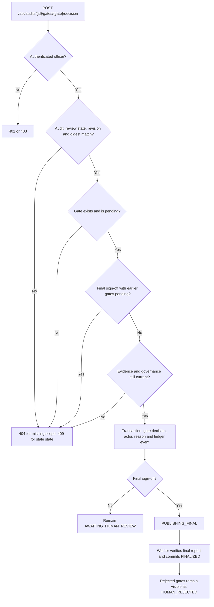

The gate handler does not waive invalid evidence, activate a policy proposal, or
submit a settlement. Governance changes cause affected working findings and
approvals to refresh; older artifacts/report versions remain historical.

### 6.3 Governed memory creation, correction, invalidation, and retrieval

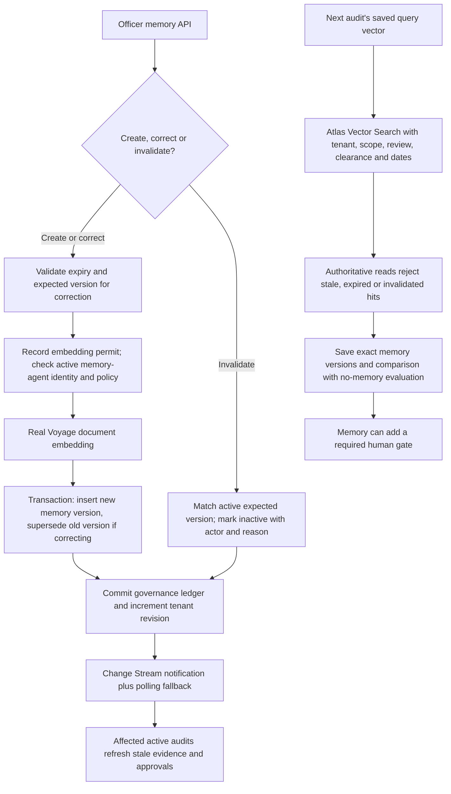

For the named memory-influence scenario, the latest eligible fixture version
must actually appear through Vector Search. Index lag creates a persisted retry;
it does not silently produce a successful memoryless demonstration.

### 6.4 Agent control, tenant pause, and policy approval

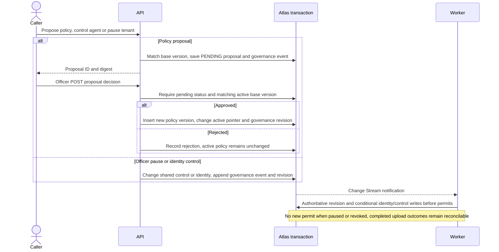

### 6.5 Retry, reconciliation, and report finalization

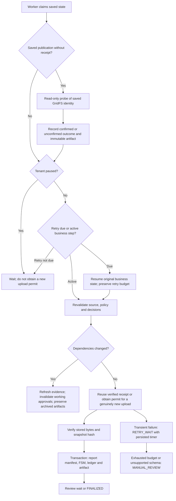

### 6.6 Report inspection and JSON export

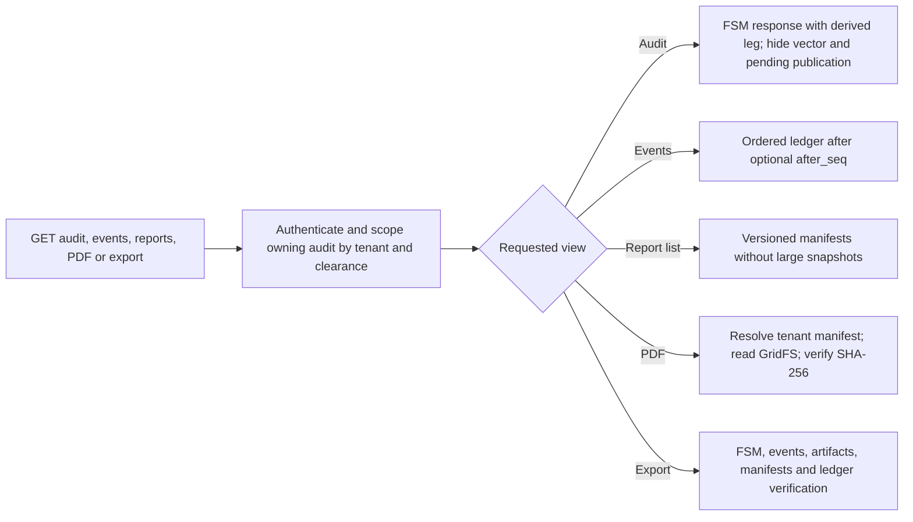

### 6.7 Sepolia submission, receipt observation, and explicit audit handoff

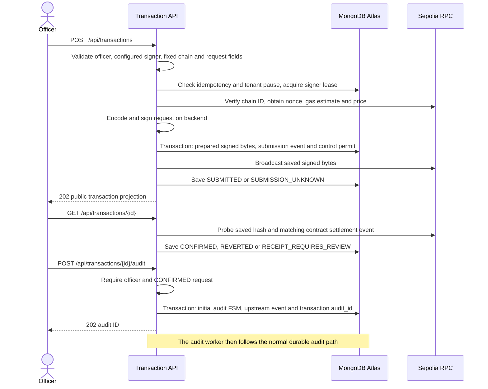

`GET /api/transactions/{id}` can update observed transaction state; it is not a
pure MongoDB read. Audit handoff is explicit, not automatic after confirmation.
Neither a successful request receipt nor scripted audit analysis establishes
completed settlement or legal clearance.

### 6.8 Separate compliance-court demo API

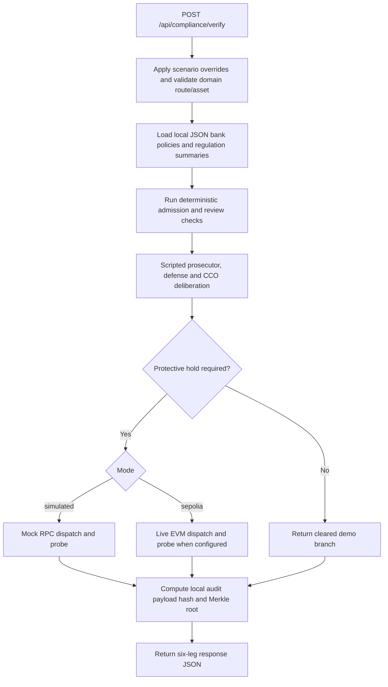

This route currently has **no bearer-auth dependency**. It loads local corpus
files and does not persist its response, court deliberation, six named legs,
or computed root to the durable audit collections. It does not call the durable
audit repository or standalone MongoDB audit-pinning service. The `sepolia`
branch can make live RPC calls, so it must not be diagrammed as the protected
officer-gated transaction API or described as harmless read-only preview.

### 6.9 Standalone persistent simulator

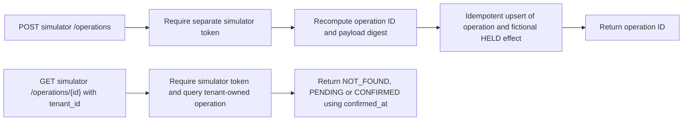

### 6.10 Discovery, health, and scaffold boundaries

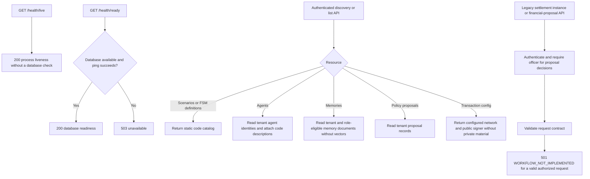

### 6.11 Complete HTTP endpoint inventory

`A/O` means authenticated analyst or officer. `O` means officer only. The
simulator token is a separate service credential. These are authorization checks
in the current handlers, not a proposed permissions model.

| Method and path | Access | Behavior / main persistence |
|---|---|---|
| `GET /api/agents` | A/O | Registry descriptions and tenant agent identities. |
| `GET /api/audits/scenarios` | A/O | Static code catalog; no database query. |
| `GET /api/audits/definition` | A/O | Executable audit state catalog; no per-audit mutation. |
| `POST /api/agents/{agent_id}/control` | O | Identity change, tenant revision, governance ledger. |
| `POST /api/audits` | A/O | Idempotent durable FSM creation; returns 202. |
| `GET /api/audits/{audit_id}` | A/O plus audit clearance | Current audit projection. |
| `GET /api/audits/{audit_id}/events` | A/O plus audit clearance | Ledger stream; `after_seq` defaults to 0. |
| `POST /api/audits/{audit_id}/gates/{gate_id}/decision` | O | Version/digest-bound officer decision. |
| `POST /api/audits/{audit_id}/retry` | O | Retry the saved manual checkpoint; unknown adapters cannot be approved into existence. |
| `GET /api/audits/{audit_id}/reports` | A/O plus audit clearance | Published manifest list. |
| `GET /api/audits/{audit_id}/reports/{version}.pdf` | A/O plus audit clearance | Verified PDF download. |
| `GET /api/audits/{audit_id}/export` | A/O plus audit clearance | State, ledger, artifacts, manifests and chain-verification result. |
| `POST /api/control` | O | Tenant pause/resume and governance record. |
| `GET /api/memories` | A/O | Analysts see eligible active memories; officers can inspect tenant history. Vectors are omitted. |
| `POST /api/memories` | O | Real document embedding and version-1 memory creation; returns 201. |
| `POST /api/memories/{memory_id}/correct` | O | Embed corrected text and atomically replace active version. |
| `POST /api/memories/{memory_id}/invalidate` | O | Version-bound logical invalidation. |
| `GET /api/agent-policies/proposals` | A/O | Tenant-owned proposal records. |
| `POST /api/agent-policies/proposals` | A/O | Pending version-bound suggestion; returns 201. |
| `POST /api/agent-policies/proposals/{proposal_id}/decision` | O | Officer policy approval/rejection. |
| `GET /api/transactions/config` | A/O | Public signer/network configuration; no private key. |
| `POST /api/transactions` | O | Backend-signed Sepolia request; returns 202. |
| `GET /api/transactions/{transaction_id}` | A/O | Receipt probe and persisted observed-state update. |
| `POST /api/transactions/{transaction_id}/audit` | O | Confirmed request-to-audit handoff; returns 202. |
| `GET /health/live` | Public | API process liveness. |
| `GET /health/ready` | Public | Database readiness; not proof that all providers/indexes are ready. |
| `GET /api/fsms/definition` | A/O | Static settlement contract; reports runtime unimplemented. |
| `POST /api/fsms` | A/O | Validated settlement scaffold; 501. |
| `GET /api/fsms/{fsm_id}` | A/O | Settlement scaffold; 501. |
| `GET /api/fsms/{fsm_id}/events` | A/O | Settlement scaffold; 501. |
| `GET /api/fsms/{fsm_id}/export` | A/O | Settlement scaffold; 501. |
| `POST /api/proposals/{proposal_id}/decision` | O | Financial proposal scaffold; 501. |
| `POST /api/compliance/verify` | Public in current code | Request-local court demo, optional live RPC; no durable audit persistence. |
| Simulator `GET /health/live`, `GET /health/ready` | Public | Separate process/readiness checks. |
| Simulator `POST /operations` | Simulator token | Durable fictional hold operation. |
| Simulator `GET /operations/{operation_id}` | Simulator token | Tenant-scoped effect probe using the required `tenant_id` query parameter. |

`/`, `/assets/...`, `/docs`, `/redoc`, and `/openapi.json` serve the workspace,
static assets, or generated API reference. They are not domain collections.
The API error boundaries include 401/403 for authentication/role failures, 404
for inaccessible/missing audit resources, 409 for stale or conflicting actions,
422 for request validation, and 503 for unavailable dependencies. Sepolia RPC
failures can return 502; the legacy settlement scaffold returns 501.

## 7. Source and diagram references

- Audit writers: [repository](../src/chainlex/audit/repository.py),
  [memory](../src/chainlex/audit/memory.py), [engine](../src/chainlex/audit/engine.py),
  [reports](../src/chainlex/audit/reports.py).
- Schema/index contracts: [bootstrap](../src/chainlex/db/indexes.py),
  [vector definitions](../src/chainlex/db/vector_indexes.json),
  [audit search provisioning](../src/chainlex/audit/search.py).
- HTTP handlers: [audit/governance](../src/chainlex/audit/api.py),
  [Sepolia requests](../src/chainlex/api/transactions.py),
  [request-to-audit bridge](../src/chainlex/api/transaction_audit.py),
  [application and court entry point](../src/chainlex/api/app.py).
- Standalone writers: [indexer](../src/chainlex/blockchain/indexer.py),
  [simulator](../src/chainlex/simulator/store.py),
  [court runner](../src/chainlex/services/e2e_runner.py).
- Mermaid notation: [entity relationships](https://mermaid.js.org/syntax/entityRelationshipDiagram.html)
  and [rendering/usage](https://mermaid.js.org/config/usage.html).
