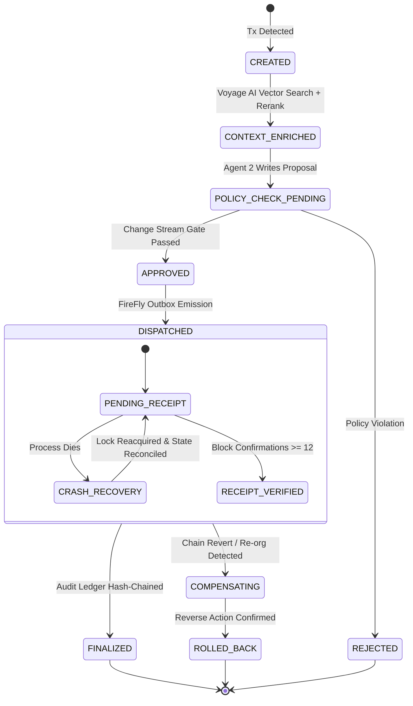

# 🚀 FireFly-FSM ChainLex: Execution Architecture & Implementation Plan

> **MongoDB x Voyage AI Hackathon (Toronto, Nov 14)**  
> *A Hyperledger FireFly-Inspired Persistent FSM for Auditable, Governed, and Crash-Resilient Blockchain Compliance Agents*

---

## 📌 Executive Summary

Enterprise blockchain workflows (Hyperledger Besu settlements, Fireblocks institutional custody, cross-chain L2 bridges) cannot tolerate probabilistic, hallucinating, or fragile AI agents. If an agent executes an unauthorized smart contract freeze or loses state mid-settlement, millions of dollars and regulatory standing are at risk.

**FireFly-FSM ChainLex** unites the architectural rigor of **Hyperledger FireFly** (transactional outboxes, idempotent state machines, receipt verification, event pinning) with **MongoDB Atlas** as the durable operational backbone and **Voyage AI (`voyage-finance-2` & `rerank-2`)** as the domain-specific retrieval engine.

---

## 🏛️ 1. Multi-Agent Workflow Specification

The system replaces black-box monolithic agents with three decoupled, deterministic micro-agents coordinated through MongoDB Atlas:

```
                       ┌────────────────────────────────────────────────────────┐
                       │                   INCOMING TRIGGER                     │
                       │   - On-chain event (Besu Settlement)                   │
                       │   - Custody transfer proposal (Fireblocks)             │
                       └───────────────────────────┬────────────────────────────┘
                                                   │
                                                   ▼
┌───────────────────────────────────────────────────────────────────────────────────────────────────┐
│ [AGENT 1: JURISDICTION & SANCTIONS DETECTIVE]                                                    │
│ 1. Extracts counterparties, resolves physical domiciles, asset route (L1/L2).                     │
│ 2. Embeds transaction context via Voyage AI (`voyage-finance-2`).                                 │
│ 3. Performs Scoped Atlas Vector Search + Native `$rerank` against `regulations` collection.       │
│ 4. Formulates a Compliance Finding (Verdict + Exact Legal Citations).                            │
└──────────────────────────────────────────────────┬────────────────────────────────────────────────┘
                                                   │
                                                   ▼
┌───────────────────────────────────────────────────────────────────────────────────────────────────┐
│ [AGENT 2: THE FIDUCIARY POLICY AUDITOR (Theme 1 Gate)]                                            │
│ 1. Checks proposed intervention against hard policy limits in MongoDB Atlas.                     │
│ 2. Evaluates Delegated Authority signature (Ed25519 token from Compliance Officer).              │
│ 3. If within policy: Generates an atomic `ActionProposal` with cryptographic simulation proof.   │
│ 4. If policy breached: Escalates to Human-in-the-Loop review queue.                              │
└──────────────────────────────────────────────────┬────────────────────────────────────────────────┘
                                                   │
                                                   ▼
┌───────────────────────────────────────────────────────────────────────────────────────────────────┐
│ [AGENT 3: THE SAGA DISPATCHER & RECONCILER (Theme 3 Engine)]                                      │
│ 1. Implements Hyperledger FireFly-style Transactional Outbox.                                     │
│ 2. Dispatches idempotently to external systems (Besu RPC contract freeze, Fireblocks vault lock). │
│ 3. Actively polls & verifies on-chain receipts until confirmed (not just sent).                  │
│ 4. Commits parent-hash chained entry to `audit_ledger` in MongoDB.                               │
└───────────────────────────────────────────────────────────────────────────────────────────────────┘
```

---

## ⚡ 2. The FireFly-Style Persistent FSM Engine

### 2.1 State Transition Diagram


### 2.2 Atomic State Advancement with Fencing Tokens
To ensure zero split-brain and total crash safety, state transitions run via atomic Compare-And-Swap (`find_one_and_update`):

```python
async def advance_fsm_state(
    db, 
    job_id: str, 
    expected_state: str, 
    next_state: str, 
    worker_id: str, 
    payload_update: dict
):
    """
    Atomic FSM transition: Guarantees state cannot advance unless
    the expected state matches AND the worker holds the active lock.
    """
    result = await db.job_executions.find_one_and_update(
        {
            "_id": job_id,
            "current_state": expected_state,
            "lock_owner": worker_id
        },
        {
            "$set": {
                "current_state": next_state,
                "updated_at": datetime.utcnow(),
                **payload_update
            },
            "$push": {
                "state_history": {
                    "from_state": expected_state,
                    "to_state": next_state,
                    "timestamp": datetime.utcnow(),
                    "worker_id": worker_id
                }
            }
        },
        return_document=ReturnDocument.AFTER
    )
    if not result:
        raise RuntimeError(f"FSM Transition Conflict: Job {job_id} not in state {expected_state} or lock expired.")
    return result
```

---

## 📦 3. Codebase Strategy: Custom Architecture vs. Starter Code

| Approach | Verdict | Rationale |
|---|---|---|
| **Generic Starter Templates (MERN / Chat RAG)** | ❌ **Reject** | Built for basic conversational chatbots. Lack transactional outboxes, idempotency keys, receipt verification, or pre-action policy gates. Wrestling with template bloat wastes hours. |
| **LangGraph Checkpointer (`langgraph-checkpoint-mongodb`)** | ✅ **Adopt Pattern** | Adopt MongoDB-backed thread checkpointing logic (`MongoDBSaver`) for high-level workflow state. |
| **Custom FireFly-FSM Micro-Engine (`pymongo` / `motor`)** | ✅ **Primary Engine** | Lightweight (<400 lines of pure Python/FastAPI), ultra-fast, zero dependencies, directly demonstrable to judges. |

---

## ⛓️ 4. Blockchain Integration & MongoDB's Coordination Role

To guarantee a reliable, deterministic demo that does not stall on testnet gas or faucet rate-limits, we build a **Dual-Mode Web3 Provider (Simulated EVM / Real Besu RPC)**.

```
┌────────────────────────────────────────────────────────────────────────┐
│                   FIREFLY-STYLE TRANSACTIONAL OUTBOX                   │
├────────────────────────────────────────────────────────────────────────┤
│                                                                        │
│   [Compliance Agent]                                                   │
│           │                                                            │
│           ▼ (Single Atomic MongoDB Transaction)                        │
│   ┌────────────────────────────────────────────────────────────────┐   │
│   │ MongoDB Atlas: Commit Job State + Insert to `tx_outbox`        │   │
│   └───────────────────────────────┬────────────────────────────────┘   │
│                                   │                                    │
│                                   ▼ (Change Stream Ingestion)          │
│   ┌────────────────────────────────────────────────────────────────┐   │
│   │ Dedicated Outbox Broadcaster Service                           │   │
│   │ - Manages nonces sequentially                                  │   │
│   │ - Emits `eth_sendRawTransaction` to Besu / EVM RPC             │   │
│   │ - Updates outbox document: state = "BROADCASTED", tx_hash      │   │
│   └───────────────────────────────┬────────────────────────────────┘   │
│                                   │                                    │
│                                   ▼                                    │
│   ┌────────────────────────────────────────────────────────────────┐   │
│   │ Active Receipt Poller (Materialized Verification)              │   │
│   │ - Polls `eth_getTransactionReceipt`                            │   │
│   │ - Requires status == 0x1 AND block_confirmations >= 12         │   │
│   │ - Signals FSM: transitions state to `RECEIPT_VERIFIED`         │   │
│   └────────────────────────────────────────────────────────────────┘   │
└────────────────────────────────────────────────────────────────────────┘
```

### How MongoDB Coordinates Blockchain Mechanics:
1. **Transactional Outbox (`tx_outbox`):** Prevents double-spending. If the agent crashes after deciding to freeze a vault, the transaction remains queued in MongoDB and resumes without re-evaluating the prompt.
2. **Receipt Verification Poller:** Distinguishes between `SENT` (HTTP 200 from node) and `MATERIALIZED` ($\ge 12$ block confirmations).
3. **Block Checkpoint Tracker (`chain_listeners`):** Stores highest finalized block number, allowing instant replay-free crash recovery.

---

## 🧠 5. Voyage AI Integration Specification

1. **Model Selection:**
   * **Corpus & Context Embedding:** `voyage-finance-2` (1024 dimensions) optimized for legal, financial, and regulatory clauses.
   * **Reranking:** `rerank-2` via Voyage API / MongoDB native `$rerank` stage.
2. **Compound Filtered Vector Search:**
   ```python
   pipeline = [
       {
           "$vectorSearch": {
               "index": "regulations_vector_idx",
               "path": "embedding",
               "queryVector": voyage_vector,
               "numCandidates": 100,
               "limit": 20,
               "filter": {
                   "$and": [
                       {"jurisdiction": {"$in": ["SGP", "EU", "USA"]}},
                       {"is_active": True}
                   ]
               }
           }
       },
       {
           "$rerank": {
               "model": "rerank-2",
               "query": query_text,
               "path": "clause_text",
               "topK": 3
           }
       }
   ]
   ```
3. **Pre-Seeded Knowledge Base:**
   * Pre-embed MAS Payment Services Act (S6, S22).
   * Pre-embed MiCA Articles (Art 68, 76, 88).
   * Pre-embed OFAC SDN digital currency sanction notices.

---

## 💡 6. Three Genius Architecture Innovations (Stage Showstoppers)

### Innovation 1: On-Chain Event Pinning Ledger
Every state transition inside Atlas writes a parent-hash chained leaf:
$$\text{Leaf}_n = \text{SHA256}(\text{JobID} + \text{State} + \text{Payload} + \text{PrevLeafHash})$$
Periodically, the agent calculates the Merkle root of the latest batch and pins a single `pinAuditRoot(bytes32 root)` transaction to Hyperledger Besu. Atlas holds the operational state; Besu provides public, non-repudiable proof.

### Innovation 2: Change Stream Circuit Breaker (<5ms Kill Switch)
Updating `db.circuit_breakers.updateOne({ network: "besu" }, { $set: { is_paused: true } })` pushes a change event that cancels in-flight agent tasks before they broadcast to the blockchain.

### Innovation 3: Self-Healing API Adaptation (Theme 3)
When an external API updates its schema (e.g., Fireblocks v1 $\rightarrow$ v2), Voyage AI embeddings match rejected field names to known semantic equivalents and re-dispatches automatically.

---

## 📅 7. Hackathon Execution Plan (Milestones to 5:00 PM)

```
[11:30 AM - 12:30 PM] ──> Milestone 1: Data Layer & Models (MongoDB Atlas + Indexes)
[12:30 PM - 01:30 PM] ──> Milestone 2: Voyage AI Seeding & Scoped Vector Search Engine
[01:30 PM - 02:45 PM] ──> Milestone 3: FireFly-FSM Core Engine & Transactional Outbox
[02:45 PM - 03:45 PM] ──> Milestone 4: Policy Gate, Change Streams & Crash Recovery Loop
[03:45 PM - 04:30 PM] ──> Milestone 5: UI Dashboard (Next.js/Streamlit) & Live Demo Script
[04:30 PM - 05:00 PM] ──> Milestone 6: Video Recording (1-min) & Cerebral Valley Submission
```

---

## 🛠️ 8. Immediate Implementation Tasks

1. **`models.py`:** Define Pydantic / BSON models for `job_executions`, `agent_action_proposals`, `governed_memory`, `audit_ledger`, and `tx_outbox`.
2. **`seed_regulations.py`:** Populate Atlas with MAS, MiCA, and OFAC regulations embedded with `voyage-finance-2`.
3. **`fsm_engine.py`:** Implement atomic state machine and transactional outbox.
4. **`blockchain_simulator.py`:** Create realistic EVM RPC interaction layer with block confirmation loops.
5. **`server.py`:** FastAPI app exposing endpoints for triggers, proposals, and live inspection.

